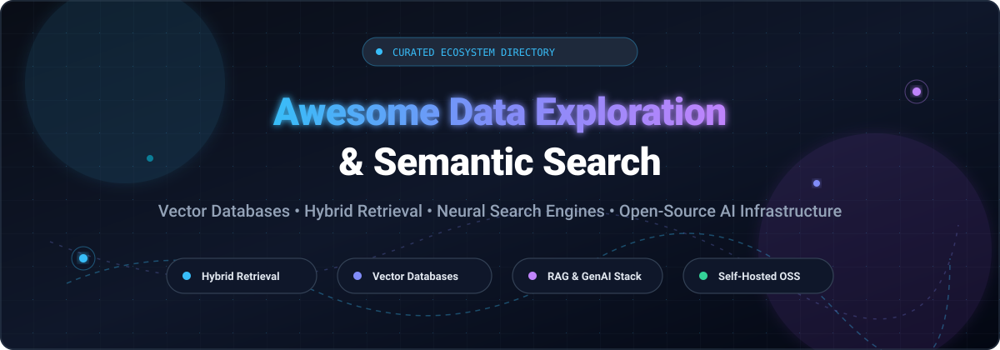

# Awesome Data Exploration & Semantic Search

  
  
  
  
  
  

  <b>🔍 Curated directory of leading SaaS platforms, vector databases, neural search engines, and open-source frameworks for Data Exploration, Hybrid Retrieval, and Semantic Search. 🚀</b>

---

> 💡 **Semantic search and data exploration platforms** transcend conventional keyword matching (BM25/TF-IDF) by fusing dense vector similarity with traditional inverted indexes. Whether engineering Retrieval-Augmented Generation (RAG) pipelines, building sub-50ms instant e-commerce discovery, or analyzing multi-terabyte internal data lakes, this repository catalogs battle-tested hosted services and self-hosted open-source technologies. 🌐

---

## 📑 Table of Contents

- [📊 Sector Overview & Market Dynamics](#-sector-overview--market-dynamics)
- [☁️ SaaS & Hosted Platforms](#️-saas--hosted-platforms)
- [🔓 Open-Source GitHub Projects](#-open-source-github-projects)
- [🧭 Architecture & Selection Guide](#-architecture--selection-guide)
- [🤝 How to Contribute](#-how-to-contribute)
- [💖 Support](#-support)
- [📈 Star History](#-star-history)
- [⚖️ Disclaimer & License](#️-disclaimer--license)

---

## 📊 Sector Overview & Market Dynamics

The global vector database and semantic search infrastructure market is estimated at **$1.7B to $3.1B**, projected to surge past **$8B+ by 2030** at an estimated CAGR of ~25%, accelerated by enterprise adoption of LLMs, agentic workflows, and RAG architectures. 📈

The sector exhibits a **bifurcated market structure**: it is **moderately fragmented at the startup and application tier** (where specialized vector databases like Qdrant, Pinecone, and Weaviate compete alongside multimodal engines like Marqo), but is rapidly shifting toward **oligopolistic concentration at the infrastructure tier** as cloud hyperscalers (AWS, Azure, GCP) and incumbent enterprise platforms (Elasticsearch, PostgreSQL via `pgvector`, Databricks, MongoDB) integrate high-performance vector search directly as a native primitive. 🏢⚡

---

## ☁️ SaaS & Hosted Platforms

Enterprise-ready hosted search engines and managed vector databases. Sorted in descending order by company scale (market cap / latest valuation). 🏢💎

| Company / Product | Company Scale (Valuation / Market Cap) | Starting Tier Pricing | Free Tier / Trial Limits | Key Strengths & Target Use Case |
| :--- | :--- | :--- | :--- | :--- |
| **[Elastic Cloud](https://www.elastic.co/)** | **~$8.5B Market Cap** *(ESTC, NYSE)* | **$95.00 / month** (Standard hosted deployment) | **14-day free trial**; 1 active deployment up to 8 GB total RAM (2 AZs × 4 GB) or 3 serverless projects (100 Search Power cap) | ⚡ Industry-standard enterprise log analytics, complex hybrid BM25 + dense vector scoring (ELSER), and multi-index faceted search. |
| **[Algolia](https://www.algolia.com/)** | **~$2.25B Valuation** *(Series D)* | **$0.50 / 1,000 searches** + **$0.40 / 1,000 records** (Grow Plan) | **Free forever plan**; up to 10,000 search requests/mo, 10,000 records, 1 application, 10 indices, and max 10 KB record size | ⚡ Sub-50ms instant search-as-you-type, React InstantSearch frontend UI libraries, and rich e-commerce conversion analytics. |
| **[Vespa Cloud](https://vespa.ai/)** | **~$1.15B Valuation** *(Piaggio Group / Spin-off context)* | **$0.05/vCPU-hr + $0.005/GB-RAM-hr** (~$35–$50/mo minimum compute) | **Free trial with $300 cloud credits**; runs on Startup tier specs with community support | ⚡ Extreme-scale hybrid retrieval, multi-billion item serving, real-time tensor computation, and complex multi-stage re-ranking. |
| **[Pinecone](https://www.pinecone.io/)** | **~$750M Valuation** *(Series B)* | **~$25.00 / month** (Serverless pay-as-you-go based on storage & read/write units) | **Free forever plan**; 1 index, up to 100,000 vectors (depending on dimension), 1 project, community support | ⚡ Serverless vector database with zero infrastructure management; premier choice for fast-prototyping LLM memory and RAG pipelines. |
| **[Coveo](https://www.coveo.com/)** | **~$350M Market Cap** *(CVO.TO, TSX)* | **$600.00 / month** (Base package; enterprise annual agreements scale $30k–$100k+) | **14-day free trial**; sandboxed environment with access to 25+ connectors, 15+ ML models, capped at 10,000 indexed items/hr | ⚡ Enterprise AI search with deep native connectors for Salesforce, ServiceNow, SAP, and large intranet knowledge bases. |
| **[Qdrant Cloud](https://cloud.qdrant.io/)** | **~$300M Valuation** *(Series B)* | **~$9.00 / month** (0.5 GB RAM cluster node) | **Free forever cluster**; 1 node with 1 GB RAM, ~0.5 vCPU, and 4 GB disk storage | ⚡ Rust-powered vector database engine offering payload-based metadata filtering, binary quantization, and predictable capacity economics. |
| **[Weaviate Cloud](https://console.weaviate.cloud/)** | **~$200M Valuation** *(Series B)* | **~$25.00 / month** (Serverless tier based on dimensions stored) | **14-day free trial** sandbox cluster; auto-expires after 14 days, limited to sandbox compute/memory capacity | ⚡ Modular schema design, native vector + keyword hybrid search, GraphQL API, and plug-and-play integrations with embedding models. |
| **[Marqo Cloud](https://www.marqo.ai/)** | **~$75M Valuation** *(Series A)* | **$0.059 / hour** (`marqo.basic` development shard, ~$43.00/mo) | **Free trial**; access to non-replicated basic development shard without high availability or SLA coverage | ⚡ End-to-end multimodal vector engine that generates embeddings internally from raw text and images, streamlining complex search pipelines. |
| **[Meilisearch Cloud](https://www.meilisearch.com/cloud)** | **~$50M Valuation** *(Early Stage)* | **$30.00 / month** (100,000 documents + 50,000 searches included) | **14-day free trial**; access to Meilisearch Cloud features across test environments | ⚡ Ultra-fast typo-tolerant search engine with vector support, tailored for developer documentation sites and intuitive consumer apps. |
| **[Typesense Cloud](https://cloud.typesense.org/)** | **Bootstrap / Lean Growth** *(Private)* | **$21.60 / month** (RAM-based dedicated cluster: 0.5 GB RAM, 1 vCPU, 10 GB SSD) | **Free trial with $50 usage credit**; valid across all cluster sizing profiles for initial testing | ⚡ High-throughput, predictable RAM-based billing that completely decouples operational costs from search query request volumes. |

---

## 🔓 Open-Source GitHub Projects

Self-hosted engines, vector stores, and neural search libraries. Sorted in descending order by GitHub stargazers count. 🌟💻

| Project | GitHub_Stars | Language | License | Primary Capabilities |
| :--- | :--- | :--- | :--- | :--- |
| **[Meilisearch](https://github.com/meilisearch/meilisearch)** |  | Rust | MIT | 🚀 Blazing-fast, typo-tolerant search-as-you-type engine with built-in vector search and zero-configuration operational simplicity. |
| **[Milvus](https://github.com/milvus-io/milvus)** |  | Go / C++ | Apache-2.0 | 🚀 Cloud-native, distributed vector database engineered for massive billion-scale vector similarity exploration and retrieval. |
| **[Qdrant](https://github.com/qdrant/qdrant)** |  | Rust | Apache-2.0 | 🚀 High-performance vector database with fine-grained JSON payload filtering, scalar/binary quantization, and SIMD hardware acceleration. |
| **[Chroma](https://github.com/chroma-core/chroma)** |  | Python / Rust | Apache-2.0 | 🚀 AI-native open-source embedding database prioritizing developer ergonomics for LLM memory, local RAG apps, and document chunking. |
| **[Typesense](https://github.com/typesense/typesense)** |  | C++ | GPL-3.0 | 🚀 In-memory, typo-tolerant search engine optimized for sub-50ms instant queries, faceted navigation, and dynamic vector embeddings. |
| **[pgvector](https://github.com/pgvector/pgvector)** |  | C | PostgreSQL | 🚀 Open-source vector similarity extension for PostgreSQL supporting HNSW and IVFFlat indexes, bringing semantic search into relational SQL. |
| **[Weaviate](https://github.com/weaviate/weaviate)** |  | Go | BSD-3-Clause | 🚀 AI-first vector database featuring native hybrid search (BM25 + vector fusion), modular vectorizers, and GraphQL query interfaces. |
| **[OpenSearch](https://github.com/opensearch-project/OpenSearch)** |  | Java | Apache-2.0 | 🚀 Community-driven distributed search and analytics suite offering robust full-text search, k-NN vector search, and observability. |
| **[txtai](https://github.com/neuml/txtai)** |  | Python | Apache-2.0 | 🚀 All-in-one embeddings database and neural framework for semantic search, LLM orchestration, language graph analysis, and RAG. |
| **[Quickwit](https://github.com/quickwit-oss/quickwit)** |  | Rust | AGPL-3.0 | 🚀 Cloud-native search engine for big data directly querying Amazon S3 / Azure Blob Storage, optimized for cost-effective log and vector indexing. |
| **[Vespa](https://github.com/vespa-engine/vespa)** |  | C++ / Java | Apache-2.0 | 🚀 Large-scale production serving engine for vector search, lexical matching, tensor math evaluation, and real-time multi-stage ranking. |

---

## 🧭 Architecture & Selection Guide

When deciding between hosted SaaS and self-hosted open-source solutions: 🎯

1. **⚡ Typo Tolerance & Instant E-Commerce Search:**  
   * **SaaS:** [Algolia](https://www.algolia.com/) (turnkey analytics & UI), [Meilisearch Cloud](https://www.meilisearch.com/cloud)  
   * **Open Source:** [Meilisearch](https://github.com/meilisearch/meilisearch) (fastest developer setup), [Typesense](https://github.com/typesense/typesense) (in-memory speed)

2. **🤖 RAG & GenAI Vector Knowledge Bases:**  
   * **SaaS:** [Pinecone](https://www.pinecone.io/) (zero management), [Qdrant Cloud](https://cloud.qdrant.io/) (payload filtering)  
   * **Open Source:** [Qdrant](https://github.com/qdrant/qdrant), [pgvector](https://github.com/pgvector/pgvector) (keep data in Postgres), [Chroma](https://github.com/chroma-core/chroma) (quick Python prototyping), [Weaviate](https://github.com/weaviate/weaviate)

3. **🏢 Massive Datasets & Multi-Stage Re-Ranking (PB-scale):**  
   * **SaaS:** [Vespa Cloud](https://vespa.ai/), [Elastic Cloud](https://www.elastic.co/)  
   * **Open Source:** [Vespa](https://github.com/vespa-engine/vespa) (tensor computation), [Milvus](https://github.com/milvus-io/milvus) (distributed clustering), [OpenSearch](https://github.com/opensearch-project/OpenSearch)

4. **🎨 Multimodal Search (Images, Audio, Video + Text):**  
   * **SaaS:** [Marqo Cloud](https://www.marqo.ai/)  
   * **Open Source:** [txtai](https://github.com/neuml/txtai)

---

## 🤝 How to Contribute

We welcome community contributions, corrections, and new project listings! 🙌

1. **Fork the repository** on GitHub. 🍴
2. **Add or update an entry** in `README.md` keeping to the tabular format:
   * SaaS entries require Company Name, Valuation/Market Cap, Starting Tier Price, Free Tier/Trial limits, and target use case.
   * Open-source entries require Project Name, Shields.io social Stars_Badge linked to stargazers, primary language, license, and summary.
3. **Ensure entries are sorted** by scale (SaaS table) or GitHub_Stars (Open-Source table). 🔢
4. **Submit a pull request** with a concise description of changes. 🚀

---

## 💖 Support

Thank you so much for exploring and using this repository! If this curated resource has helped you or your team evaluate semantic search engines and vector architectures, please consider supporting the project:

- ⭐ **Star this repository** to help others discover it on GitHub.
- 🍴 **Fork and contribute** updates or additional engines.
- 📢 **Share with your colleagues** on LinkedIn, X/Twitter, and Discord communities.
- ☕ **Buy a coffee & sponsor ongoing maintenance:**  
    
  *Support via the [GitHub Sponsors Dashboard](https://github.com/sponsors/ishandutta2007).*

---

##  Star History

---

## ⚖️ Disclaimer & License

- 📖 This list is community-curated for informational and architectural comparison purposes. It is not an endorsement.
- 🏷️ All product names, logos, and brands are property of their respective owners.
- ⚖️ Distributed under the [MIT License](LICENSE).
